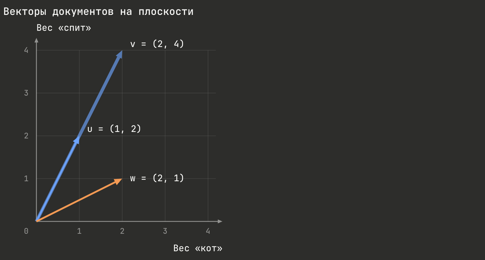

# Текстовый энкодер для семантического поиска

## Классическая векторная модель поиска

### Частота термина и взвешивание

Каждому термину словаря соответствует координата вектора документа. Значение координаты — вес термина. У отсутствующих терминов вес равен нулю.

**IDF** измеряет редкость термина $t$ в коллекции.

$$
\mathrm{idf}_t = \log \frac{N}{\mathrm{df}_t}
$$

$N$ — число документов в коллекции, $\mathrm{df}_t$ — число документов, где термин $t$ встречается хотя бы раз.

**TF‑IDF** — вес термина $t$ в документе $d$. Частоту $\mathrm{tf}_{t,d}$, то есть число вхождений термина в этот документ, умножают на IDF.

$$
\mathrm{tfidf}_{t,d} = \mathrm{tf}_{t,d}\cdot \mathrm{idf}_t
$$

Если термин есть только в одном из 100 документов и повторяется в нём трижды, то при десятичном логарифме IDF равен $2$, а TF‑IDF — $3\cdot2=6$.

### Косинусное сходство

Пусть $\mathbf u$ и $\mathbf v$ — ненулевые векторы TF‑IDF двух документов в общем пространстве терминов.

$$
\operatorname{sim}(\mathbf u,\mathbf v)
= \frac{\mathbf u\cdot\mathbf v}{\|\mathbf u\|\,\|\mathbf v\|}
$$

$\mathbf u\cdot\mathbf v$ — сумма произведений соответствующих координат, а $\|\mathbf u\|$ и $\|\mathbf v\|$ — длины векторов. Деление на длины компенсирует масштаб весов. Например, векторы $[1,2]$ и $[2,4]$ направлены одинаково, и их сходство равно $1$.

### Вектор запроса и ранжирование

Запрос представляют в том же пространстве, что и документы. Инвертированный индекс для каждого термина запроса даёт список документов, где он встречается. Для этих документов накапливают произведения весов совпавших терминов, делят баллы на длины векторов документов и выбирают $K$ документов с наибольшим баллом. $K$ — число результатов.

Источник — Мэннинг, Рагхаван, Шютце. «Введение в информационный поиск», §6.2–6.3.

## Поиск по плотным векторам в проекте

Один и тот же энкодер $E$ кодирует вопросы и фрагменты. Текущий `WordMeanEncoder` усредняет обученные векторы знакомых слов и получает вектор из $d$ координат.

Векторы фрагментов вычисляем заранее и сохраняем в PostgreSQL. При поиске кодируем вопрос и сравниваем его с сохранёнными векторами выбранного проекта и той же версии энкодера. Балл равен скалярному произведению.

$$
\operatorname{sim}(q,p)=E(q)^\top E(p)
$$

$q$ — вопрос, $p$ — фрагмент. pgvector возвращает до $k$ фрагментов с наибольшим баллом, где $k$ — запрошенное число результатов.

Источник схемы поиска — Karpukhin и др. *Dense Passage Retrieval for Open-Domain Question Answering*, EMNLP 2020, §3.1.

## Обучение энкодера

Обучающий пример состоит из вопроса, подходящего фрагмента и одного неподходящего. Подходящий фрагмент задан в разметке. Среди остальных бенчмарк выбирает фрагмент с наибольшим числом общих слов с вопросом.

Энкодер обучается давать подходящему фрагменту больший балл. Функция потерь измеряет, сколько не хватает до требуемого разрыва.

$$
L = \max(0, \Delta + s_- - s_+)
$$

$s_+$ и $s_-$ — скалярные произведения вектора вопроса с векторами подходящего и неподходящего фрагментов, $\Delta$ — требуемый разрыв. Если $s_+ - s_- \ge \Delta$, потеря $L$ равна нулю. Веса обновляются на примерах с положительной потерей.

Источник — Karpukhin и др. *Dense Passage Retrieval for Open-Domain Question Answering*, EMNLP 2020. Подбор обучающих фрагментов описан в §3.2, а близкая к нашей функция потерь с разрывом — в приложении B.
